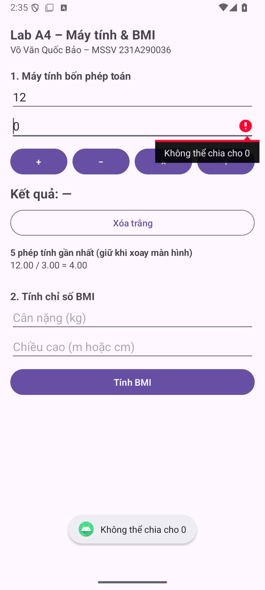
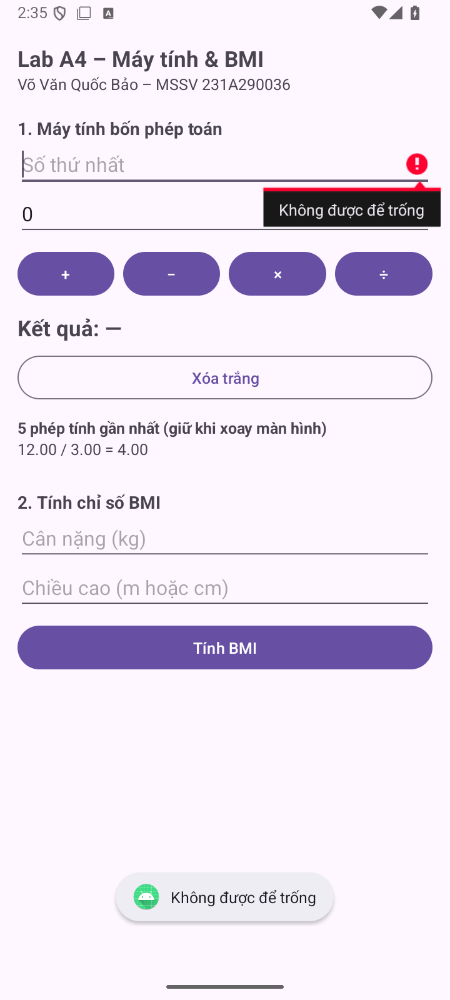
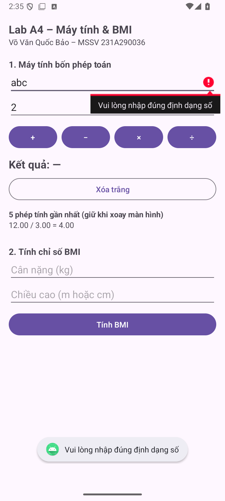
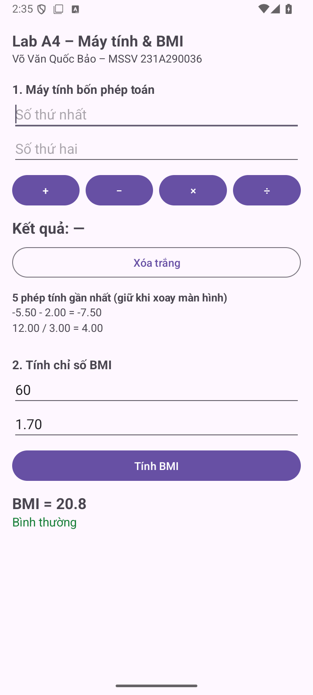
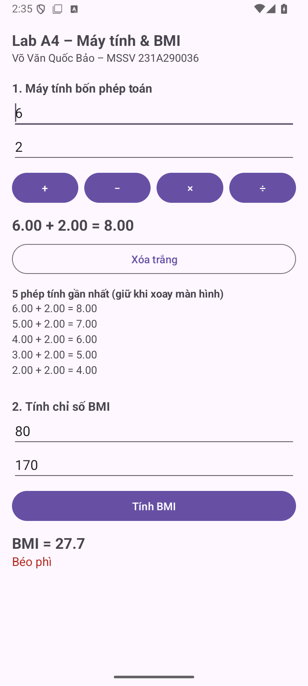
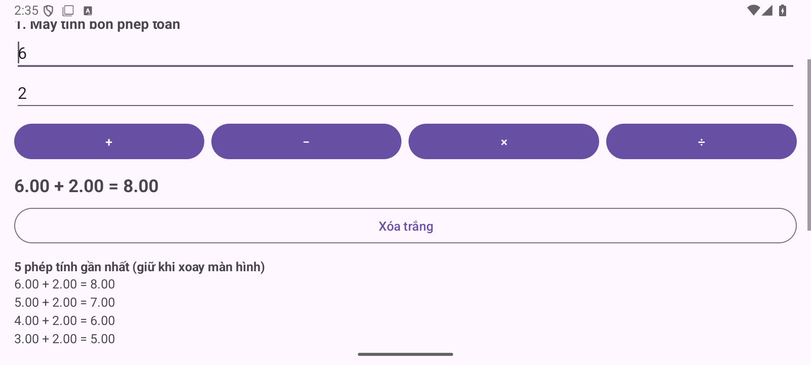

# BÁO CÁO LAB A4 - TextView, Button, EditText và xử lý sự kiện
Họ tên: Võ Văn Quốc Bảo  |  MSSV: 231A290036

Học phần: INT4211 - Lập trình trên các thiết bị di động. Ngày kiểm chứng: 20/10/2026.

Repository: https://github.com/VOVANQUOCBAO/A4_231A290036

## 1. Sản phẩm và phần nâng cao

Ứng dụng gồm máy tính cộng, trừ, nhân, chia và tính BMI. Dữ liệu được trim, kiểm tra rỗng, kiểm tra định dạng trong try-catch, kiểm tra miền giá trị và quy tắc phép toán. Từ chối NaN, Infinity, đầu vào hoặc kết quả vượt giới hạn double.

NC2: lưu tối đa 5 phép tính gần nhất bằng ArrayList và onSaveInstanceState, giữ sau khi xoay. NC3: đổi màu phân loại BMI: bình thường xanh, thừa cân vàng nâu, béo phì đỏ, thiếu cân xanh dương. Ngưỡng theo đề: 18.5 / 23 / 25.

## 2. Bảng 10 test case đã chạy

| # | Dữ liệu / thao tác | Mong đợi | Thực tế |
| --- | --- | --- | --- |
| 1 | 12 / 3 | 4.00 | Đạt: 4.00 |
| 2 | 12 / 0 | Lỗi ô B | Đạt: không chia cho 0 |
| 3 | A rỗng, bấm + | Lỗi ô A; focus A | Đạt |
| 4 | A = abc, bấm × | Sai định dạng, không crash | Đạt |
| 5 | -5.5 - 2 | -7.50 | Đạt: -7.50 |
| 6 | A = 1.5.5 | Sai định dạng | Đạt |
| 7 | 60 kg; 1.70 m | BMI 20.8; bình thường | Đạt |
| 8 | 60 kg; 170 cm | BMI 20.8; bình thường | Đạt |
| 9 | Chiều cao = 0 | Lỗi, không Infinity | Đạt |
| 10 | A = 1e309 (vượt double) | Báo sai định dạng / giới hạn | Đạt: không crash |

Các ca chữ, hai dấu chấm và số mũ được bộ kiểm thử đưa trực tiếp vào EditText để kiểm chứng lớp xử lý dữ liệu độc lập với bộ lọc bàn phím. Đây là dữ liệu kiểm thử thô; ứng dụng vẫn dùng bàn phím số.

---

## 3. Ảnh minh chứng lỗi

Ba ảnh gốc từ máy ảo cho thấy lỗi tại đúng ô nhập, kèm thông báo; ứng dụng tiếp tục hoạt động.

## Kiểm tra bổ sung

Đạt các kiểm tra cộng/nhân, ranh giới BMI 18.5/23/25, NaN, Infinity, dấu trừ đơn, dấu phẩy, chuỗi rỗng, tràn kết quả, giới hạn 5 dòng lịch sử, giữ lịch sử sau khi xoay và nút Xóa trắng. Lỗi nhập BMI xóa kết quả cũ trước khi báo lỗi.

---

## 4. BMI và phần nâng cao

---

## 5. Trả lời 5 câu hỏi ôn tập

1. Ba bước xử lý sự kiện; vì sao findViewById sau setContentView?

Ánh xạ View → đăng ký listener → xử lý sự kiện. setContentView nạp cây giao diện; tìm View trước đó không tìm được đúng cây và có thể trả null.

2. Vì sao inputType không thay thế kiểm tra trong code?

inputType chọn cách nhập và bàn phím. Không bảo đảm mọi nguồn dữ liệu đều đúng; vẫn phải kiểm tra rỗng, định dạng và giá trị tại nơi tính toán.

3. Bốn lớp kiểm tra và ví dụ?

Rỗng: A chưa nhập. Định dạng: abc không phải số. Miền giá trị: số phải hữu hạn, cân nặng/chiều cao > 0. Nghiệp vụ: không chia cho 0; chiều cao > 3 được đổi từ cm sang m theo quy ước của đề.

4. Khi nào dùng setError và Toast?

setError gắn lỗi vào ô cần sửa và requestFocus đưa con trỏ tới đó. Toast dùng cho thông báo ngắn; bài này kết hợp cả hai khi nhập số sai hoặc vi phạm điều kiện tính.

5. Vì sao truyền Locale vào String.format?

Locale quyết định dấu thập phân và cách định dạng số. Truyền Locale.getDefault làm ý định rõ ràng và hiển thị theo thiết lập máy; không có nghĩa mọi locale đều cho cùng một dấu thập phân.

## Môi trường và phạm vi kiểm chứng

Project Java + XML; minSdk 24, targetSdk/compileSdk 35, Java 17. Android Gradle Plugin 9.0.1; Gradle Wrapper 9.1.0. Máy ảo Medium Phone, Android API 36. Bộ kiểm thử instrumentation đạt 22 phép kiểm tra trong lượt chính.

APK được build và cài thật lên máy ảo. Ảnh ứng dụng được chụp trực tiếp từ máy ảo; video quay màn hình bằng adb screenrecord. Chưa kiểm chứng trên điện thoại thật hoặc máy API 24. Nhật ký gốc và kết quả lint nằm trong KiemThu/.

## Tệp nộp và khả năng tái lập

Thư mục gốc là project mở trực tiếp bằng Android Studio. APK/ chứa bản debug có chữ ký để cài thử; BaoCao/ chứa PDF và bản Markdown có thể sửa; AnhMinhChung/ chứa ảnh gốc; Video/ chứa video demo; KiemThu/ chứa log, báo cáo lint và cách chạy lại kiểm thử.

Nguồn yêu cầu: Lab_A4_HuongDanThucHanh.pdf do người dùng cung cấp. Repository để Private. Không gửi lời mời giảng viên theo yêu cầu của chủ tài khoản.
